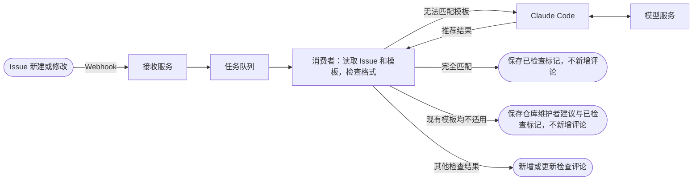

# CommunityGovAgent

社区智能化治理智能体

## Issue 治理智能体

### 当前功能

当前实现 issue 模板检查功能：**Issue 触发 → 读取标题、正文和模板 → 检查 → 通过时静默记录，否则评论反馈**。

输入：Issue 新建，或修改标题、描述。

输出：

| 情况 | 检查结果 | 原因 | 模板推荐 | 其他 |
| --- | --- | --- | --- | --- |
| 完整匹配 | 通过 | — | — | 不发表评论，保存已检查标记 |
| 部分匹配 | 不通过 | 具体缺项或格式问题 | 对应模板及可复制内容（折叠展示） | — |
| 未匹配，推荐成功 | 不通过 | 推荐理由 | 唯一推荐模板及可复制内容（折叠展示） | — |
| 未匹配，无适用模板 | 通过 | — | — | 不发表评论；建议原因、建议文本、仓库维护者名单及 Issue 关联写入通用表 |
| 未匹配，信息不足无法推荐 | 不通过 | 缺少哪些判断诉求的信息 | 提示补充信息，并列出全部模板及可复制内容（逐个折叠展示） | — |
| 模板缺失、解析失败或字段配置无效 | 暂无法检查：仓库模板配置异常 | — | — | 列出问题文件与原因，按 `repository.yml` 中该仓库的名单 @ 对应账号 |
| 程序出错 | 不发布评论，进入任务重试 | — | — | — |

能推荐时优先推荐唯一模板，候选重叠按提示词规则选择；只有无法判断诉求类别时才返回信息不足。折叠块中提供模板标题和正文 Markdown，供作者复制后自行填写；表中的“—”表示不展示该字段。

相邻两次 Issue 修改间隔不超过 3 分钟且已有本服务评论时，更新原评论，包括更新为通过结果。

当前仅检查基础格式并推荐模板，不判断问题是否真实、分类是否正确或信息是否充分。

接收服务校验 Webhook 后把任务写入队列。消费者读取 Issue 和仓库模板、完成检查，并在需要时调用模型。同一 Issue 同时只有一条任务在处理。

### 仓库使用方式

接入仓库、Webhook 地址和 `WEBHOOK_SECRET` 通过本仓库的 Issue 确认。使用和实现上的问题通过 [Issue](https://github.com/oss-compass/CommunityGovAgent/issues) 或 Pull Request 交流。

1. 在 Issue 中说明要接入的 `owner/repo`，并确保服务账号能读取该仓库的 Issue、模板，以及发表评论。
2. 确认仓库默认分支已有 Issue 模板，支持 YAML 表单和 Markdown 文件；仓库没有模板时，回退读取所属组织 `.gitcode` 仓库默认分支中的公共模板。
3. 在仓库中进入 **项目设置 → WebHook → 新建 WebHook**，填写以下内容：

| 项目 | 填写内容 |
| --- | --- |
| URL | Issue 中确认的 Webhook 地址 |
| 认证方式 | 选择 **WebHook 密码**，不要选择“签名密钥” |
| 密码 | Issue 中确认的 `WEBHOOK_SECRET` |
| POST 内容类型 | `application/json` |
| 事件类型 | 仅勾选「Issue 事件」|
| 启用状态 | 勾选「激活」|

文档在 [docs](docs/README.md)。交给其他 agent 的说明是 [docs/integration.md](docs/integration.md)。
