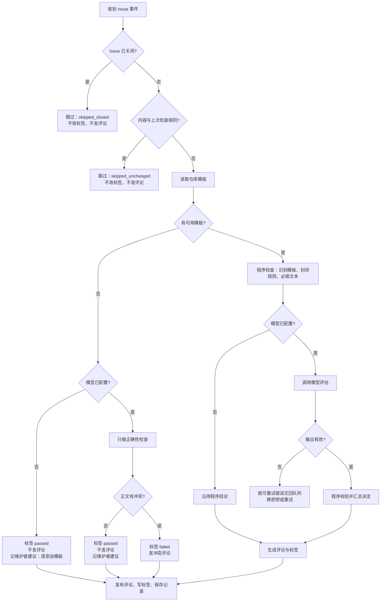
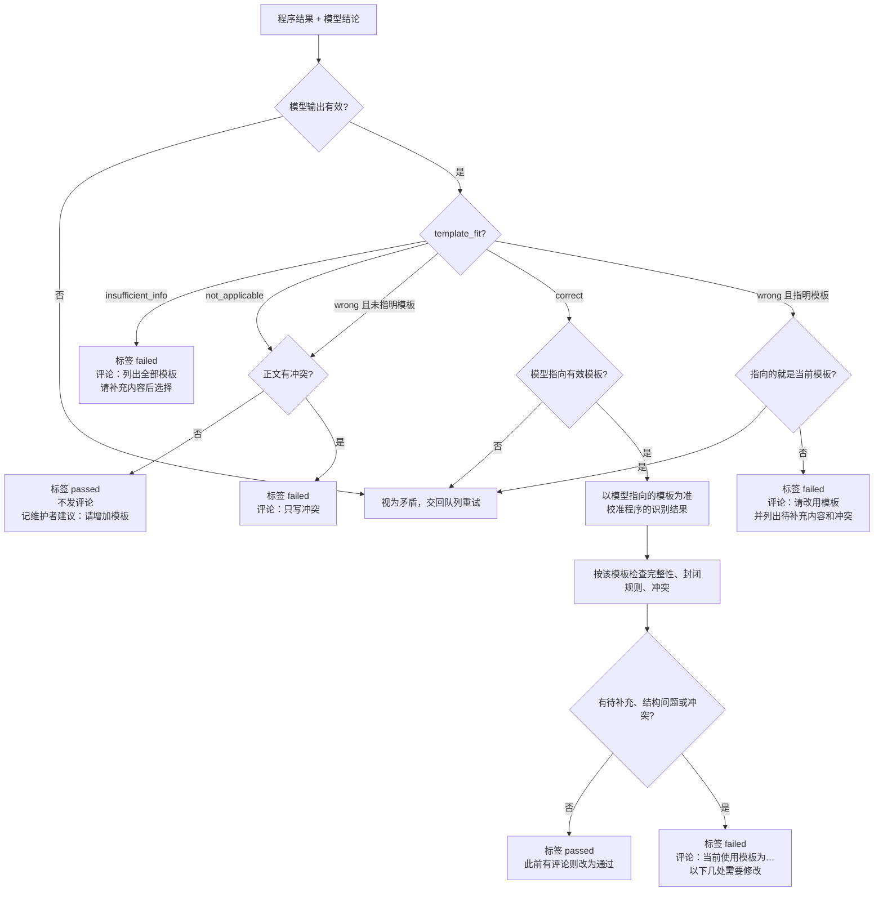
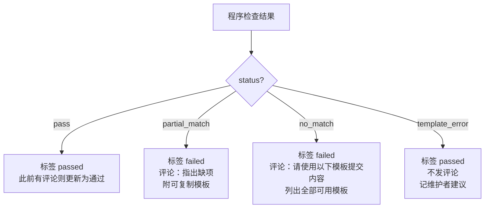
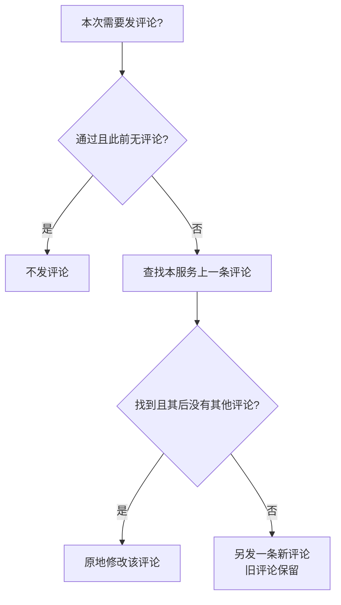

# Issue 评估标准与流程

本文说明一次 Issue 评估检查什么、由谁检查、每条分支的标签和评论是什么。接入和部署见 [integration.md](integration.md)。

## 一、评估标准

一次评估检查三件事，顺序固定：先用对模板，再看内容是否完整，最后看正文是否自洽。程序负责能按规则判定的部分，模型负责需要读懂内容才能判定的部分，最终结论由程序汇总。

### 三个维度

| 维度 | 检查什么 | 程序 | 模型 |
| --- | --- | --- | --- |
| 规范性 | 是否在用仓库的某一份模板：标题前缀、章节是否对得上、下拉值是否在候选项内、必选复选框是否勾选、是否用对了该用的那份 | 解析模板；按标题前缀和章节匹配当前模板；下拉值和必选复选框的结论直接生效 | 判断模板用对、用错、都不适用、看不出属于哪一类；用错时指明应改用哪份 |
| 完整性 | 当前模板的每个必填文本是否有章节、是否写了实际内容、内容是否对得上字段要求 | 列出必填文本字段，给出缺失、为空或已填写的初步结论 | 逐项复核全部必填文本，附正文证据；未提供的写明要补充什么 |
| 正确性 | 正文内部是否自洽：版本与环境、步骤与结果、预期与实际 | 切分正文并编号；校验每条冲突的类别、片段编号和说明 | 找出前后不一致的地方，每条给出类别、两个片段编号和说明 |

### 程序与模型怎么配合

| 维度 | 情形 | 处理 |
| --- | --- | --- |
| 规范性 | 程序唯一认定当前模板，模型也说用对并指向同一份 | 以该模板为准，继续查完整性和正确性 |
| 规范性 | 程序识别错或没识别到，模型说用对并指向某一份 | 以模型指向的为准，程序结论被校准；再按该模板查完整性和正确性 |
| 规范性 | 模型说用错，指的却是程序认定的当前模板 | 视为矛盾，本次输出作废，任务重试 |
| 规范性 | 模型说用错，指明了另一份 | 建议改用，同时列出该模板下还缺什么、正文哪里不一致 |
| 规范性 | 模型说用错，但指不出应改用哪份 | 不建议模板，只查正确性，记维护者建议 |
| 规范性 | 模型指出的模板名不在仓库模板列表内 | 本次输出作废，任务重试 |
| 完整性 | 程序认定已填写，模型未提及 | 保持已填写 |
| 完整性 | 模型判定已提供，证据编号真实存在 | 清除程序原判的缺失或为空 |
| 完整性 | 模型判定已提供或部分提供，但证据编号不存在 | 降为未提供 |
| 完整性 | 模型判定未提供 | 按未提供处理，提示语用模型写的补充要求，没有则用字段说明 |
| 正确性 | 单条冲突的类别、片段编号或说明不合规 | 丢弃该条，其余照常 |
| 正确性 | 冲突清单本身不是列表 | 整份输出作废，任务重试 |
| 正确性 | 没有可用模板 | 只做正确性检查；无冲突标签记为通过，有冲突发冲突评论 |
| 正确性 | 模型未配置 | 做不了正确性检查，结论按程序结果走 |

模型不输出通过或不通过，只给出模板结论、字段复核和冲突清单。最终结论、评论和标签由程序汇总决定。

## 二、评估流程

### 整体流程

模型超时、鉴权失败或输出无法识别时，任务在 5 秒后重新投递，并按密钥规则轮换；全部密钥失败后进入死信队列。模型失败不会被写成最终结论。

### 有可用模板时的判定流程

### 未配置模型时的判定流程

## 三、标签

标签只有两个，写入一个时移除另一个。仓库需要事先创建这两个标签，服务不会自动创建。

| 标签 | 写入时机 |
| --- | --- |
| `issue-check-passed` | 模板用对且内容完整、正文无冲突；或现有模板都不适用且正文无冲突；或仓库没有可用模板且正文无冲突 |
| `issue-check-failed` | 其余所有完成评估的情况，包括模板用错、内容待补充、正文有冲突、看不出属于哪一类、未配置模型但未匹配模板 |

标签写入失败不影响任务完成，只在该任务结果里记 `label_action=rejected`。新标签写成功后才移除相反标签，避免仓库缺少新标签时把原标签清掉。

## 四、评论

### 发布规则

- 通过且此前没有本服务评论：不发评论。
- 通过且此前有评论：把那条评论改为通过。
- 未通过：发表未通过评论。
- 上一条本服务评论仍是最后一条：原地修改。
- 其后已有其他评论：另发一条，旧评论保留。

### 评论样式

所有评论以 `### 提交内容检查：未通过` 或 `### 提交内容检查：通过` 开头，只写提交者需要处理的部分。模型生成的文字会转义，不包含链接和 @ 提及。

| 场景 | 首句 | 后续内容 |
| --- | --- | --- |
| 通过 | 当前提交内容符合要求，可以继续处理。 | — |
| 建议改用模板 | 模型给出的原因 | 请改用模板 **名称**。请展开以下内容，复制后替换现有正文。附模板折叠块、待补充内容、前后描述不一致 |
| 看不出属于哪一类 | 模型给出的原因 | 请补充具体内容后，从以下模板中选择一份填写。列出全部模板 |
| 未使用模板且未配置模型 | 请使用以下模板提交内容。 | 列出全部可用模板 |
| 模板用对但有问题的 | 当前使用模板为 **名称**，此处需要修改。／以下几处需要修改。 | 分「选项」「待补充内容」「前后描述不一致」三节 |
| 只报冲突 | 正文里有一处描述不一致，请核对后修改：／正文里有几处描述不一致，请核对后修改： | 逐条列出冲突 |

未配置模型但程序匹配到模板时，评论沿用旧样式，标题为「提交内容规范性检查」，内容是指出缺项并附可复制模板。

## 五、结果汇总

| 场景 | status | 标签 | 评论 |
| --- | --- | --- | --- |
| 模板用对，内容完整，正文无冲突 | `pass` | passed | 此前无评论不发；有则改为通过 |
| 模板用对，但有缺项、结构问题或冲突 | `partial_match` | failed | 列出需要修改的项 |
| 模板用错或未使用，已选出应改用的模板 | `no_match` | failed | 请改用模板，附模板和待补充内容 |
| 模板用错且未指明应改用哪一份，或现有模板都不适用，正文有冲突 | `no_match` | failed | 只写冲突，记维护者建议 |
| 模板用错且未指明应改用哪一份，或现有模板都不适用，正文无冲突 | `no_match` | passed | 不发评论，记维护者建议 |
| 看不出属于哪一类 | `no_match` | failed | 列出全部模板，请补充内容 |
| 仓库没有可用模板，正文无冲突 | `template_error` | passed | 不发评论，记维护者建议 |
| 仓库没有可用模板，正文有冲突 | `template_error` | failed | 只写冲突 |
| 未配置模型，程序匹配到模板 | `pass` / `partial_match` | 随程序结论 | 沿用旧样式 |
| 未配置模型，未匹配模板 | `no_match` | failed | 请使用以下模板提交内容 |
| 内容与上次检查相同 | `skipped_unchanged` | 不改 | 不发 |
| Issue 已关闭 | `skipped_closed` | 不改 | 不发 |
